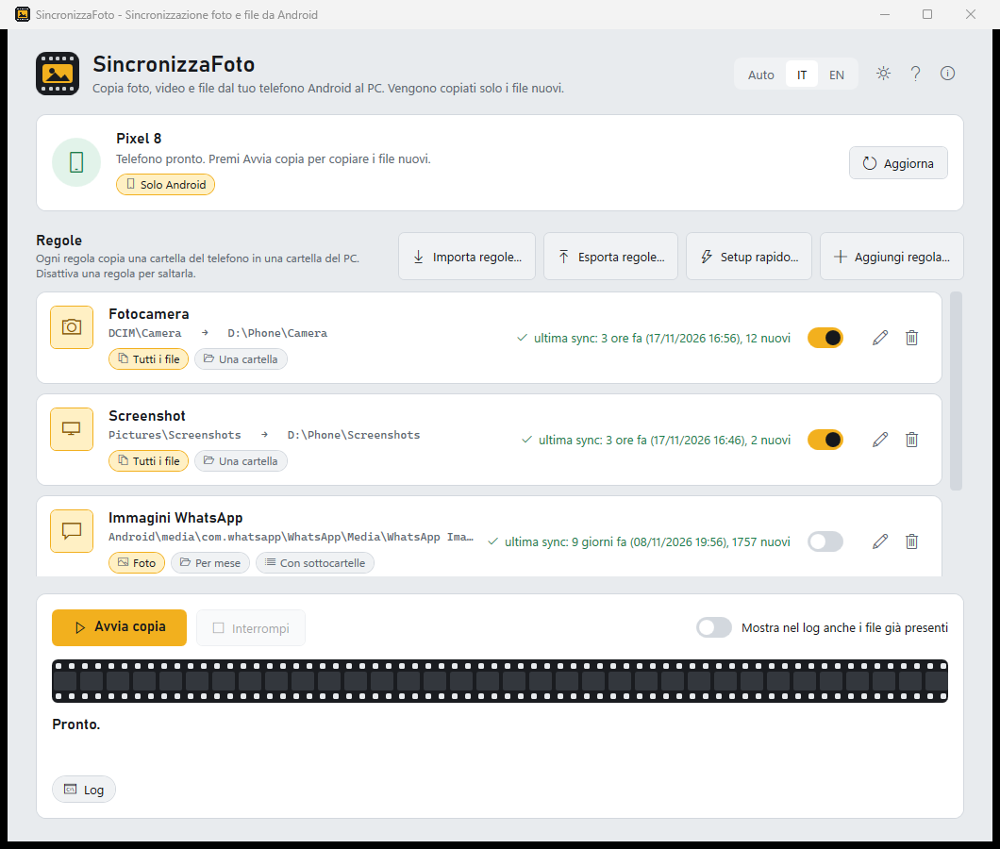
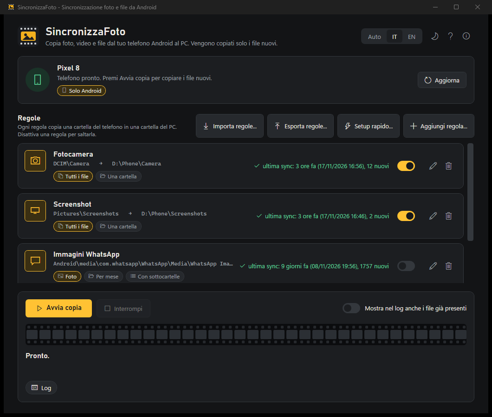
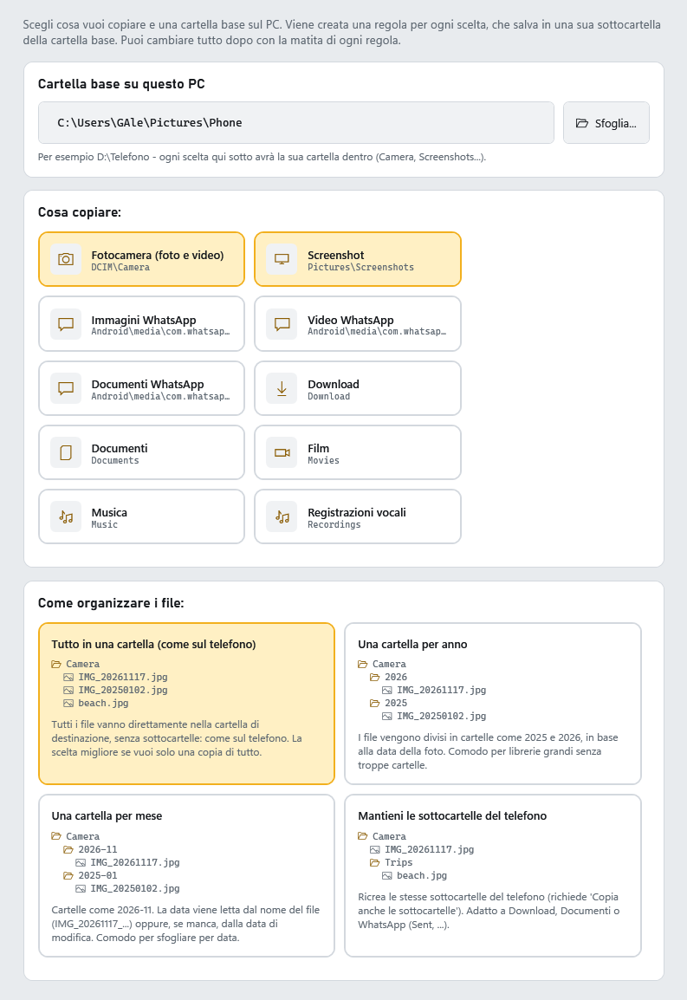
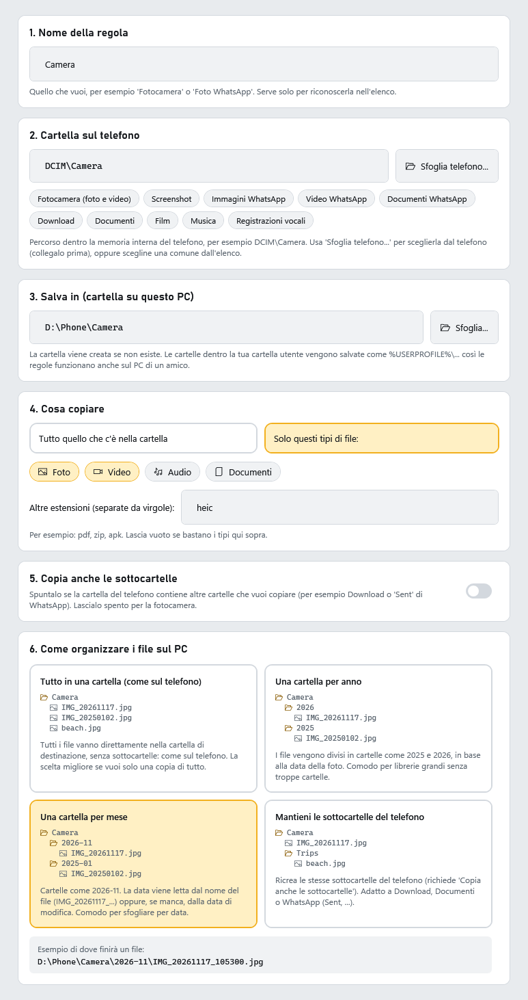

# SincronizzaFoto

**Copia foto, video e file dal tuo telefono Android al PC Windows. Solo ciò che è nuovo. Senza installare nulla.**

*[Read in English](README.md)*

> ### Solo Android
> Funziona con telefoni **Android** collegati via cavo USB (MTP, modalità "Trasferimento file"). **iPhone e iPad non sono supportati.**

## Perché

Windows mostra un telefono Android come "dispositivo portatile", non come una lettera di unità: per questo `cmd` e gli script non possono semplicemente fare `copy`. Copiare a mano la cartella della fotocamera ogni volta è lento, e non sai mai quali foto sono già sul PC.

SincronizzaFoto è una piccola finestra che ricorda cosa hai già copiato, copia solo i file nuovi e non cancella né sovrascrive mai nulla.

## Funzioni

- **Copia solo i file nuovi** - stesso nome e stessa dimensione significa "già presente". Puoi lanciarlo quante volte vuoi.
- **Regole modificabili in una finestra** - *cartella del telefono -> cartella del PC*, con un editor guidato e il pulsante *Sfoglia telefono* per scegliere le cartelle direttamente dal telefono.
- **Setup rapido** - spunta *Fotocamera*, *Screenshot*, *WhatsApp*... scegli una cartella base, fatto.
- **Scegli tu come organizzare i file** - tutto in una cartella (come sul telefono), una cartella per anno, una per mese, oppure mantieni le sottocartelle del telefono.
- **Filtra per tipo** - foto, video, audio, documenti, o le tue estensioni.
- **Non si blocca mai** - la copia gira in background, con contatori, avanzamento e log in tempo reale. Le cartelle enormi (migliaia di foto di WhatsApp) non sono un problema.
- **Riordina ciò che hai già copiato** - hai cambiato come una regola organizza i file? Un clic sposta i file già sul PC nella nuova struttura (prima l'anteprima, nulla viene cancellato o sovrascritto).
- **Copia diretta** - i file vengono letti direttamente dal telefono: niente finestra «Copia in corso...» di Windows, e l'avanzamento si muove anche dentro i video grandi. Se un telefono la rifiuta, ricade sulla copia di Windows (e lo scrive nel log).
- **Sicuro** - non cancella mai dal telefono, non sovrascrive mai un file sul PC (un file diverso con lo stesso nome viene salvato come `nome (1).jpg`).
- **Portatile** - tutto il programma è una cartella con un `config.json`. Copiala su una chiavetta, oppure esporta le regole e mandale a un amico.
- **Un design con un punto di vista** - uno stile piatto e sobrio da «tavolo luminoso», con un tema scuro da «camera oscura», e una **pellicola** che mostra l'avanzamento mentre legge e copia. Costruito con WPF, che è già in Windows: anche qui non si installa nulla.
- **Italiano e inglese**, scelti in automatico da Windows (e cambiabili nella finestra). Facile aggiungerne altre.
- **Libero e open source** (MIT). PowerShell semplice: nessun installer, nessuna dipendenza, nulla di cui fidarsi tranne il codice.

## Screenshot









## Avvio rapido

1. Collega il telefono Android con un cavo USB, **sbloccalo** e scegli **Trasferimento file** nella notifica USB.
2. Scarica questa cartella e fai doppio clic su **`Start.bat`**.
3. Al primo avvio premi **Sì** per il Setup rapido, scegli una cartella sul PC e premi **Avvia copia**.

La guida completa per chi parte da zero - compreso come scegliere l'organizzazione - è qui:
**[docs/GUIDE.it.md](docs/GUIDE.it.md)** (disponibile anche dentro il programma con il pulsante *Guida*).

## Requisiti

- Windows 10 o 11 (usa Windows PowerShell 5.1, già incluso in Windows).
- Un telefono **Android** e un cavo USB per i dati.

## Condividere la tua configurazione con un amico

- Copia tutta la cartella: le regole sono in `config.json`, non serve altro.
- Oppure premi **Esporta regole...** e manda il file `.json`; il tuo amico preme **Importa regole...**. I percorsi dentro la cartella utente sono salvati come `%USERPROFILE%\...`, quindi vanno bene su qualsiasi PC.

## Struttura del progetto

```
Start.bat               lanciatore (doppio clic)
SincronizzaFoto.ps1     punto di ingresso
src\                    il programma (core, traduzioni, lavoro di copia, finestre WPF)
ui\                     stili XAML e palette chiara/scura
assets\                 icona dell'app (generata da tools\make-icon.ps1)
lang\                   traduzioni (en.json, it.json)
docs\                   guide per l'utente
tools\check.ps1         controlli di sintassi e traduzioni per i collaboratori
```

## Contribuire

Segnalazioni di bug, traduzioni e pull request sono benvenute. Vedi **[CONTRIBUTING.md](CONTRIBUTING.md)** (in inglese): spiega anche la modalità *telefono finto*, per lavorarci senza un telefono.

## Crediti

Fatto da **GAle** e **Claude** (Anthropic).

- GAle: l'idea, lo Xiaomi Mi 9T, i test e una pazienza infinita.
- Claude: il codice, i bug e (alla fine) le correzioni dei bug.
- Laboratorio di test ufficiale: uno Xiaomi Mi 9T, 1055 foto, 26 duplicati e una cartella WhatsApp lunghissima. Nessun telefono è stato maltrattato; parecchi duplicati sì.

## Marchi

WhatsApp, Android e gli altri nomi sono marchi dei rispettivi proprietari. Questo progetto è indipendente e non è affiliato né approvato da nessuno di loro. Per questo non include i loro loghi: le regole usano icone generiche.

## Licenza

[MIT](LICENSE). Libero di usare, copiare, modificare e condividere. Nessuna garanzia: tieni una copia di ciò che conta.
