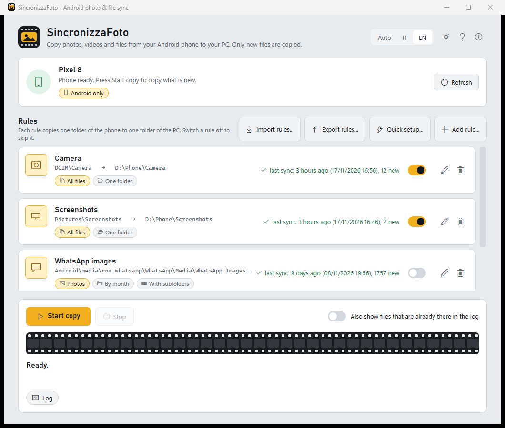
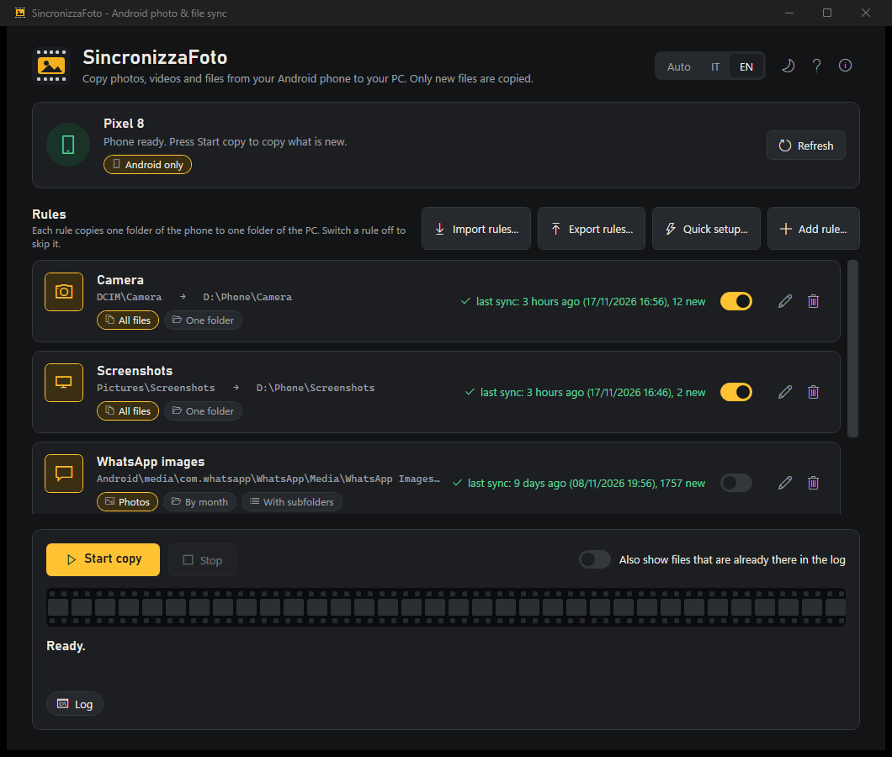
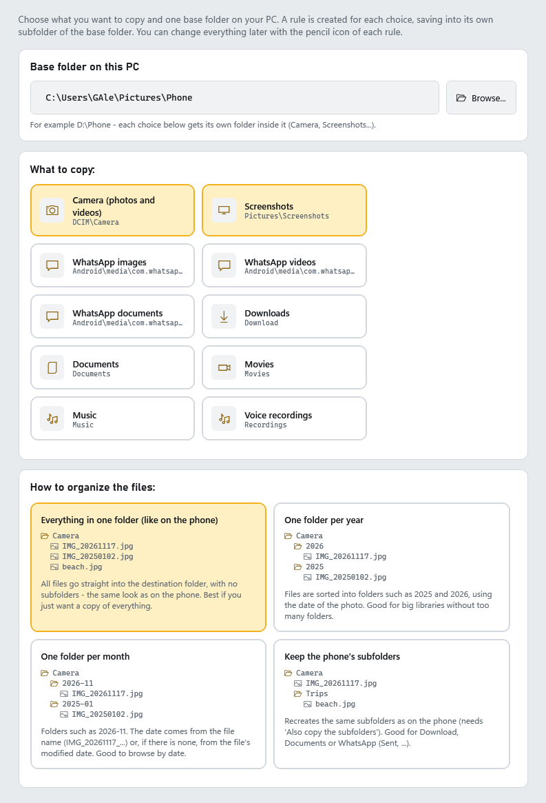
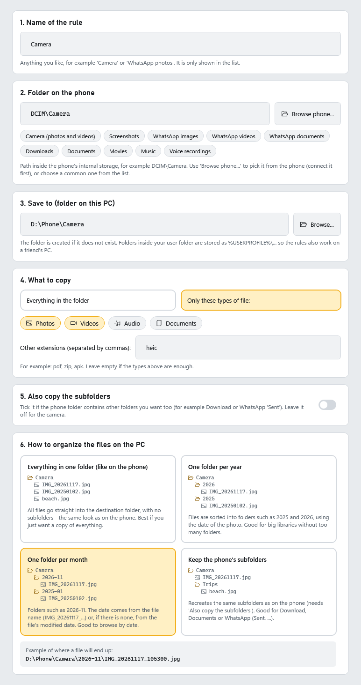

# SincronizzaFoto

**Copy photos, videos and files from your Android phone to your Windows PC. Only what is new. No installation.**

*[Leggi in italiano](README.it.md)*

> ### Android only
> It works with **Android** phones connected by USB cable (MTP, "File transfer" mode). **iPhone and iPad are not supported.**

## Why

Windows shows an Android phone as a "portable device", not as a drive letter, so scripts and `cmd` cannot simply `copy` from it. Copying the camera folder by hand every time is slow, and you never know which photos are already on the PC.

SincronizzaFoto is a small window that remembers what you have already copied, copies only the new files, and never deletes or overwrites anything.

## Features

- **Copies only new files** - same name and same size means "already there". Run it as often as you like.
- **Rules you can edit in a window** - *phone folder -> PC folder*, with a guided editor and a *Browse phone* button to pick folders straight from the phone.
- **Quick setup** - tick *Camera*, *Screenshots*, *WhatsApp*... pick one base folder, done.
- **You choose how files are organized** - everything in one folder (like on the phone), one folder per year, one per month, or keep the phone's subfolders.
- **Filter by type** - photos, videos, audio, documents, or your own extensions.
- **Never freezes** - the copy runs in the background, with live counters, progress and a log. Huge folders (thousands of WhatsApp photos) are fine.
- **Tidy up what you already copied** - changed how a rule organizes files? One click moves the files already on the PC into the new structure (preview first, nothing deleted or overwritten).
- **Direct copy** - files are read straight from the phone: no Windows "Copying..." window, and the progress moves inside big videos too. If a phone refuses, it falls back to the Windows copy (and says so in the log).
- **Safe** - never deletes from the phone, never overwrites a file on the PC (a different file with the same name is saved as `name (1).jpg`).
- **Portable** - the whole program is one folder with a `config.json`. Copy it to a USB stick, or export your rules and send them to a friend.
- **A design with a point of view** - a flat, calm "lightbox" look with a "darkroom" dark theme, and a **film strip** that shows the progress while it reads and copies. Built with WPF, which comes with Windows: still nothing to install.
- **English and Italian**, chosen automatically from Windows (and switchable in the window). Easy to add more.
- **Free and open source** (MIT). Plain PowerShell: no installer, no dependencies, nothing to trust but the source.

## Screenshots









## Quick start

1. Connect your Android phone with a USB cable, **unlock it**, and choose **File transfer** in the USB notification.
2. Download this folder and double-click **`Start.bat`**.
3. On the first run press **Yes** for the Quick setup, pick a folder on your PC, and press **Start copy**.

The full, beginner-friendly walkthrough - including how to choose the organization - is in the guide:
**[docs/GUIDE.en.md](docs/GUIDE.en.md)** (also available inside the program with the *Help* button).

## Requirements

- Windows 10 or 11 (uses the Windows PowerShell 5.1 that comes with Windows).
- An **Android** phone and a USB data cable.

## Sharing your setup with a friend

- Copy the whole folder: your rules are in `config.json`, nothing else is needed.
- Or press **Export rules...** and send the `.json` file; your friend presses **Import rules...**. Paths under the user folder are stored as `%USERPROFILE%\...`, so they fit any PC.

## Project layout

```
Start.bat               launcher (double-click)
SincronizzaFoto.ps1     entry point
src\                    the program (core, i18n, worker, WPF windows)
ui\                     XAML styles and the light/dark palettes
assets\                 app icon (generated by tools\make-icon.ps1)
lang\                   translations (en.json, it.json)
docs\                   user guides
tools\check.ps1         syntax / translation checks for contributors
```

## Contributing

Bug reports, translations and pull requests are welcome. See **[CONTRIBUTING.md](CONTRIBUTING.md)** - it also explains the *fake phone* test mode, so you can work on it without a phone.

## Credits

Made by **GAle** and **Claude** (Anthropic).

- GAle: the idea, the Xiaomi Mi 9T, the testing and endless patience.
- Claude: the code, the bugs and (eventually) the bug fixes.
- Official test lab: one Xiaomi Mi 9T, 1055 photos, 26 duplicates and one extremely long WhatsApp folder. No phones were harmed; several duplicates were.

## Trademarks

WhatsApp, Android and other names are trademarks of their owners. This project is independent and is not affiliated with, or endorsed by, any of them. For that reason it does not ship their logos: rules use generic icons.

## License

[MIT](LICENSE). Free to use, copy, modify and share. No warranty: keep a backup of what matters.
